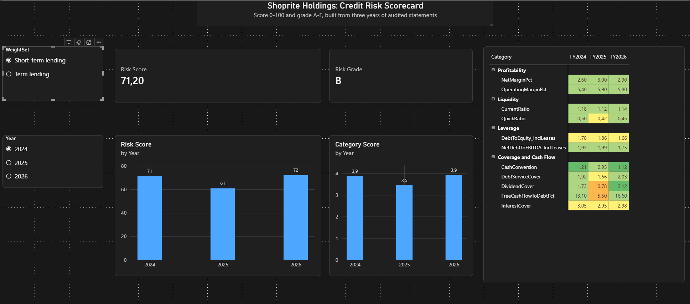
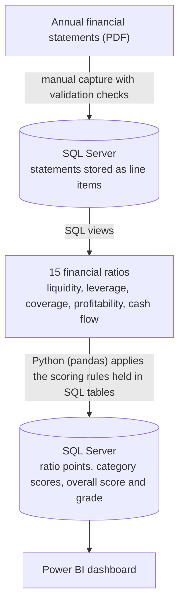

# Corporate Credit Risk Scorecard

A SQL Server, Python and Power BI project that turns a company's financial statements into a transparent **credit risk score (0-100) and letter grade (A-E)**, to help a lender judge whether lending to the company is a good idea.

Worked example: **Shoprite Holdings** (JSE: SHP), financial years 2024 to 2026.



---

## The problem

Deciding whether to lend to a company means reading three financial statements, calculating a dozen ratios, and judging them against sensible benchmarks. Done by hand, it is slow, inconsistent between analysts, and hard to audit. This project builds the whole chain in a repeatable way: the statements go in, and a score comes out together with the reasoning behind it.

## Results for the worked example

| Financial year | Short-term lending | Term lending |
|---|---|---|
| FY2024 | 71.2 (B) | 71.2 (B) |
| FY2025 | 60.9 (C) | 58.9 (C) |
| FY2026 | 72.2 (B) | 73.0 (B) |

**What the model shows:**
- **FY2025 is the weak year, and the weakness sits in one category.** The *Coverage and Cash Flow* category score falls to 2.8 out of 5 (from 4.0 and 4.2). Working capital absorbed about R2.3 billion of cash, free cash flow was about R3.1 billion, and dividends paid were about R4.0 billion, so free cash flow covered only 0.78x of dividends.
- **FY2026 recovers.** Free cash flow rises to about R9.3 billion, net debt to EBITDA (including leases) falls from 1.99x to 1.75x, and a R1.2 billion short-term facility is repaid.
- **Leverage is steady** at around 1.7-1.9x debt to equity once leases are included. Financial debt excluding leases is low (0.20x equity in FY2026).

## How it works



| Layer | Tool | Responsibility |
|---|---|---|
| Storage and ratios | SQL Server Express, T-SQL | Statements, line item definitions, ratio views, scoring rules, results |
| Scoring engine | Python (pandas, SQLAlchemy, pyodbc) | Reads ratios and rules, scores each period, writes results back |
| Presentation | Power BI (DAX) | Score cards, category and trend charts, ratio heatmap |

### The scoring method

1. **Eleven ratios** are scored from 1 (weak) to 5 (strong) using bands stored in a `ScoreBand` table.
2. Ratios are averaged within **four categories**: Liquidity, Leverage, Coverage and Cash Flow, Profitability.
3. Categories are combined with **weights that depend on the type of lending**:

| Category | Short-term lending | Term lending |
|---|---|---|
| Liquidity | 35% | 15% |
| Leverage | 30% | 30% |
| Coverage and Cash Flow | 20% | 35% |
| Profitability | 15% | 20% |

   Short-term loans (working capital facilities) are repaid mainly from turning stock and receivables into cash, so liquidity matters most. Multi-year term loans are repaid from cash generated over time, so coverage and cash flow matter most.
4. The weighted average (1 to 5) is rescaled to **0-100**: `(average - 1) / 4 x 100`.
5. The score maps to a grade: **A** 80 or more, **B** 65-80, **C** 50-65, **D** 35-50, **E** below 35.

**Industry adjustment.** Four ratios (current ratio, quick ratio, operating margin, net margin) have separate bands for *Retail - Food and Grocery*, because a food retailer's thin margins and low liquidity are normal for the industry. Other ratios use default bands. All thresholds, weights and grade cutoffs live in SQL tables, so a judgment can be changed by editing a row, not code.

### Data quality controls

- Every statement's subtotals are reconciled with SQL check queries (for example, the balance sheet equation, gross profit to profit for the year, and cash flow subtotals to closing cash).
- Database constraints prevent duplicate values, invalid statement types and orphaned rows.
- Every data load checks for unmatched line item names before inserting, and checks row counts afterwards.
- A band validation query checks for gaps and overlaps in the scoring bands.
- Edge cases are handled: zero denominators (`NULLIF`), negative equity (worst band), and zero or negative EBITDA (leverage ratio set to a "not meaningful" value that scores worst).

## Key modelling decisions and assumptions

- **Units:** ZAR millions, as reported.
- **Restated figures:** FY2026 and FY2025 come from the FY2026 report (FY2025 income statement restated for discontinued operations). FY2024 comes from the FY2025 report's comparative column, which is on a slightly different restatement basis, so the FY2024 to FY2025 trend is not perfectly like-for-like. Balance sheets were not restated.
- **Borrowings** include bank overdrafts and other short-term facilities. **Lease liabilities** are kept separate, and leverage ratios include them.
- **EBITDA** = operating profit + depreciation and amortisation.
- **Free cash flow** = operating cash flow before dividends - capital expenditure - lease repayments.
- **Debt service cover** = (cash generated from operations - tax paid - maintenance capex) / (interest paid + lease repayments + debt repayments).
- Exact formulas are in the SQL view definitions.

## Repository structure

```
sql/
  01_schema/            table definitions
  02_load_data/         line item definitions, company and periods, statement loads, validation checks
  03_views/             key figures, ratios, cash flow figures, cash flow ratios
  04_scorecard/         scoring tables, band seeds, band checks, score output tables
  development_tests/    early scripts used to test the schema (not part of the build)
python/                 scoring script and connection test
powerbi/                Power BI dashboard (.pbix)
docs/                   dashboard screenshot
```

## How to rebuild

1. Install SQL Server Express and SSMS, and create an empty database called `CreditRisk`.
2. Run the scripts in `sql/` in this folder order: `01_schema`, `02_load_data`, `03_views`, `04_scorecard`. Within each folder, run in numeric order. Scripts with `check` in the name (and `29_load_status.sql`) are validation queries: they should return zeros or zero rows, or the expected row counts.
3. Install Python 3.13 (pyodbc did not have a prebuilt package for 3.15 at the time of writing) and the Microsoft ODBC Driver 18 for SQL Server.
4. `py -3.13 -m pip install -r python/requirements.txt`
5. Set your server name (environment variable `CREDITRISK_SERVER`, or edit `SERVER` in `python/score_companies.py`) and run `py -3.13 python/score_companies.py`.
6. Open `powerbi/CreditRisk_PowerBI.pbix` in Power BI Desktop and refresh.

## Limitations

- **Bands and weights are expert-judgment assumptions, not calibrated** against default data. The scores are a structured, transparent view of a company, not a prediction of default.
- **One company so far.** Industry bands cannot be properly tested without peers.
- **Band scoring has cliff effects:** a ratio just under a boundary earns fewer points than one just over it.
- **No red-flag overrides yet.** Audit opinions are not yet recorded, and rules such as negative equity or a qualified opinion capping the grade are not implemented.
- Statements were entered manually from published annual reports.

## Roadmap

- Red-flag overrides (audit opinion, negative equity, going-concern warnings)
- Debt capacity: recalculate leverage and debt service cover for a proposed loan
- A contrast company (for example Pick n Pay) to test whether the model separates stronger from weaker, and to validate the food-retail bands against peers
- A Streamlit data-entry front end, and later PDF extraction of statements
- Interpolated scoring to smooth the cliff effects

## Data source and disclaimer

Financial data were transcribed from Shoprite Holdings' publicly available annual financial statements for FY2024-FY2026. This is a learning and portfolio project. It is not affiliated with Shoprite Holdings, and its scores are **not** an assessment of the company's actual creditworthiness, nor financial or credit advice.

## About

Built by Hugo, Business and Data Analyst (Power BI and SQL), with a BCom in Risk Management and Economics.
